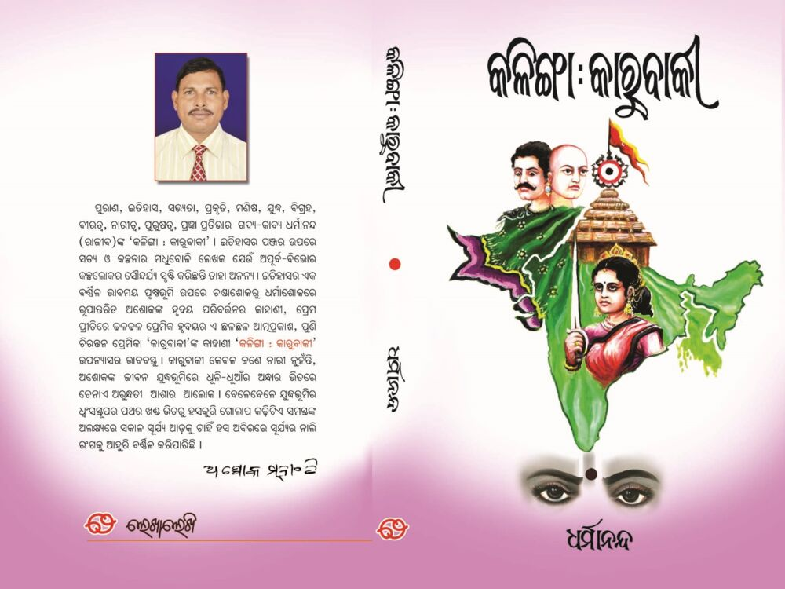

---
# Feel free to add content and custom Front Matter to this file.
# To modify the layout, see https://jekyllrb.com/docs/themes/#overriding-theme-defaults

layout: home
---
# New Discovery
{: .text-center .fs-9 .fw-700 }

## Musical Word Making | Secret of Students Creative Talent | Practice Daily for Creative Excellence
{: .text-center .fs-6 }

## New Knowledge of Word Making
{: .text-center }

  
  

A great dream comes true. Mahatma Dharmananda.  
In honour of our beloved Gurudev , Christ like soul in human frame , Mahavatar Sri Sri Sri Babaji Maharaj . Pranam . Humbly pray for instant spiritual benefit.

World famous VEDICENGLISH is dedicated in honour of Gaani Devi, a great teacher and a divine soul of inspiration. The daughter of India should be rewarded by our graceful people who dream India first and to serve the mankind first. Pranam pranam. Send your good will message to gaani.usi [at] gmail.com.

Dedicated to the great ancestors of Mahatma Dharmananda ( Duryodhana - kanchana, Bahudi - Ranga, Banchanidhi Achyuta, Sadhu Sahoo, Village - Jahangirapatana, Banamalipura, Puri)

Knowledge of Word Making is very important, innovative and inspiring for all students of schools and colleges.  
Vedic English enables automatic flow of words in the mind, to write and speak immediately without thinking for
words. Language and litreature is more difficult to learn than Science and Mathematics. Till date no simple method
was discovered for students. Vedic English is a new method to improve in any mothertongue by knowing word making of adjectives, adverbs, nouns and verbs. It is the grace of God to save mothertongue and to achieve mastery over many languages. For it's profound importance it is followed in all schools and colleges of the world and
popular among students in every home.  
Till date we learn alphabets, words, word meaning (dictionary), grammar , prose poetry and story, and also read
single words. For this reason we can't write and speak spontaneously without thinking. Knowledge of Word Making is innovative to teach the world in musical way for the first time to excel in English.  
  
**Daily listen audio of Vedic English for 10 minutes in International/Indian voice to achieve mastery over the words, good command over word power, easily remember and recall, to improve creative hidden talent within you.**  
  
**Spread this website to your friends through twitter ,whatsapp ,facebook and other social networking sites. To excel in English language easily, one should read and write 2000 "and" words, 200 strong verbs. It helps spontaneous command over word power to speak and write immediately.**  

__When you read the word beautiful you must read all words i.e beautiful flower, beautiful queen, beautiful nature, beautiful palace, beautiful valley, beautiful sunrise, beautiful moon light, beautiful expression, beautiful feeling, beautiful scenery, beautiful poem, beautiful art, beautiful garden. It helps to remember all words easily in a musical way so one can recall immediately.__  

This site is dedicated to all the school children across the globe, who face difficulties in speaking and writing in English and other mother-tongue.  



## <mark>Must Read and Remember (Students' Paradise of Words)</mark>

<ul>
  
    <li>
      <a href="{{ post.url }}">{{ post.title }}</a>
    </li>
  
</ul>

## [Kalinga Karubaki: Princess of Love and War (Click here)](/assets/files/Kalinga_Karubaki.pdf) (Odia)

## [Kalinga Karubaki: Princess of Love and War (Click here)](/assets/files/Kalinga_Karubaki_translated.pdf) (Translated)
